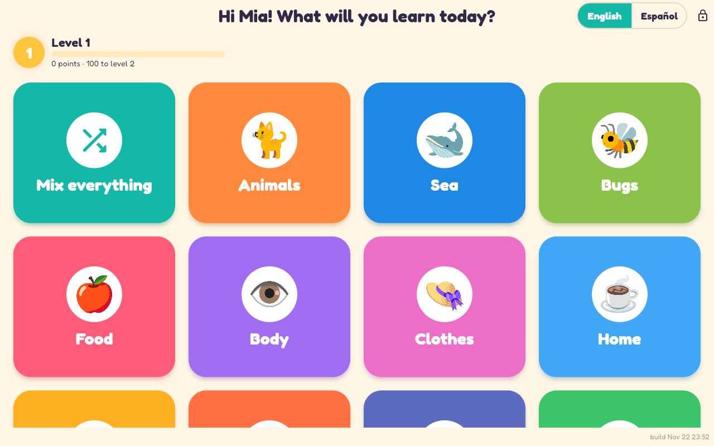
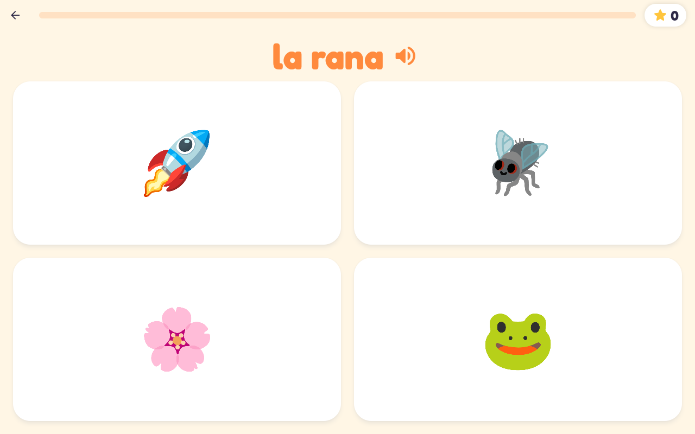
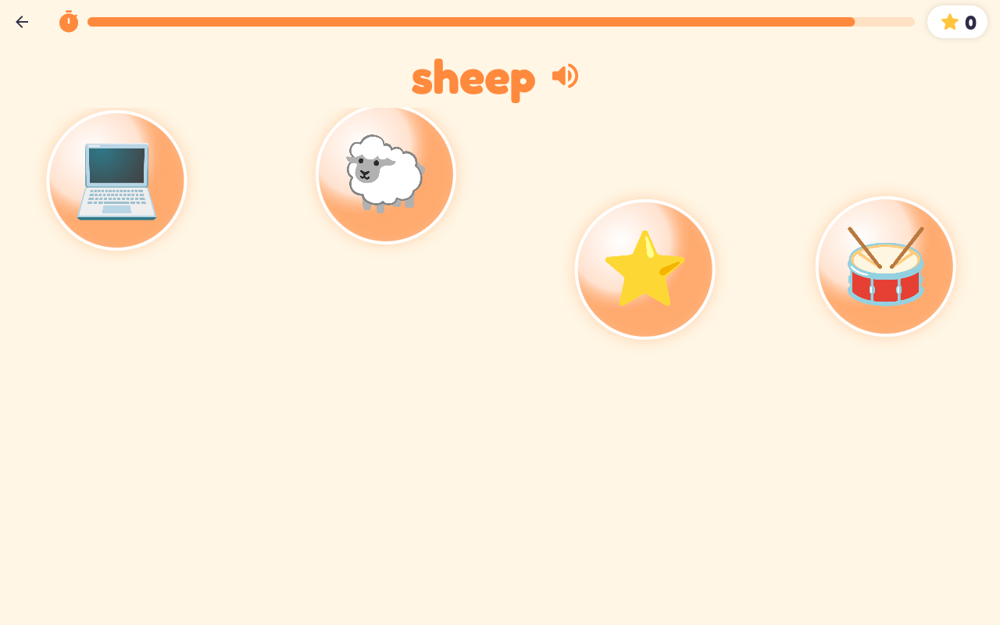
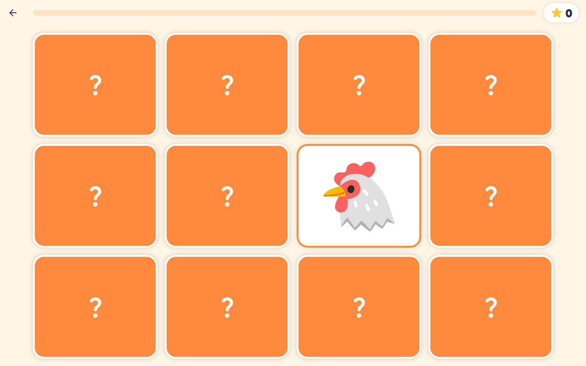

# Adaptive Vocab

**A bilingual, picture-first vocabulary game for early learners that works
out which words each child is forgetting and brings them back at the right
moment.**

<p align="center">
  
  
  
  
</p>

## Why this exists

Most children's vocabulary apps present words in a fixed order: every child
sees the same list, whether they already know a word or have missed it five
times. That works poorly in the classrooms this project is designed for:
elementary schools with limited resources, where many children are still
learning to read and a single tablet is shared by the whole class.

Adaptive Vocab treats every answer as information. It keeps a separate
learning history for each child and uses it to decide what to practise next,
how hard each question should be, and when a word is due for review. It does
all of this on the device, with no accounts, no internet connection and no
data leaving the classroom.

## How it adapts

Every answer is recorded: which word was asked, what the child picked, and
how long they took. From that history the app builds a picture of each word
for each child.

**Spaced review.** Each word sits in one of five
[Leitner](https://en.wikipedia.org/wiki/Leitner_system) boxes. A correct
answer moves it up one box; a miss sends it back to the start. The higher the
box, the longer the app waits before asking again: 30 seconds, 5 minutes,
1 day, 3 days, then 7 days.

**What to ask next.** The next word is chosen in this order:

1. If the child has missed 2 of their last 3 answers, a word they already
   know, so a session never turns into a run of failures.
2. The word that is most overdue for review.
3. A word the child has not seen yet.
4. The word closest to being due.

Words from the last three questions are skipped when possible, and no word
is asked twice in the same round.

**How hard each question is.** The wrong answers are the hidden difficulty
dial. While a word is new or shaky, the other choices come from different
groups (apple vs. car, shoe, bird). Once the child knows it, the choices come
from the same group (apple vs. orange, grape, banana), starting with words
the child has actually confused it with before. Harder questions are worth
more points.

**Mistakes are remembered precisely.** The app does not just record that a
child got "apple" wrong. It records that they picked "orange", and uses that
pair again later.

## Games

| Game | How it plays | What it tells the app |
| --- | --- | --- |
| **Cards** | Picture, word, spoken audio and a short fun fact | Exposure only |
| **Find it** | Hear a word, tap its picture out of four | Right or wrong, and which wrong word |
| **Bubble Pop** | 60 seconds; pop the right picture before it floats away. Bubbles speed up with every correct answer | Right, wrong or too slow |
| **Flip & Match** | Find each picture's word among face-down cards | Practice; a wrong flip is a memory slip, not a vocabulary mistake |

Each game draws its words from the same adaptive engine. Children can play a
single group (Animals, Food, Body, and nine more) or **Mix everything**.

## Built for the classroom

- **Picture and voice first.** Every word has a picture and is read aloud,
  so children who cannot read yet can still play.
- **English and Spanish.** One tap switches every word, fun fact, voice and
  label. Spanish is Latin American and taught with its article ("el gato").
  Progress is tracked per language: knowing "cat" does not mean knowing
  "el gato".
- **Motivation without ranking.** Points, streaks, levels and a personal
  best in each test game. Children compete only with their own previous score, never
  with each other.
- **Teacher tools.** Behind a passcode: the current child's words sorted
  from weakest to strongest, with what they confuse each one with; a
  demonstration mode that explains why each word and each wrong option was
  chosen; and a points reset for a new term.
- **Offline.** Words, pictures and fonts are bundled with the app, and all
  progress is stored on the device.

## Content

143 concrete nouns in 12 groups: animals, sea, bugs, food, body, clothes,
home, school, play, transport, nature and music. Each word has a picture and
a one-sentence fact for children, in both languages. Groups deliberately
include related words (eye, ear, nose) so same-group questions are genuinely
harder, and avoid look-alike pictures (squid and octopus) that would make
them unfair. See [`content/README.md`](content/README.md).

## Built with

- [Flutter](https://flutter.dev) and Dart, currently running in Chrome
- SQLite through [sqflite](https://pub.dev/packages/sqflite), compiled to
  WebAssembly in the browser
- On-device text-to-speech
- An append-only answer log, with all per-word statistics derived from it, so
  the adaptive rules can change without losing data

The adaptive logic is a set of pure functions, separate from storage and UI,
and is covered by automated tests along with the games and storage.

## Running it

```sh
flutter pub get
flutter test
flutter run -d chrome
```

See [`docs/DEVELOPMENT.md`](docs/DEVELOPMENT.md) for the production build,
the project layout and how content is edited, and
[`docs/INTEGRATION.md`](docs/INTEGRATION.md) for embedding the game in
another Flutter app.

## What's next

- Review of the Spanish content by a native speaker
- A simulation study comparing the adaptive order with a fixed word order
- Recorded voices to replace text-to-speech

## About

Built by **Ankush Rai** as a CSEN 293 Directed Research project at Santa
Clara University, supervised by Prof. Silvia Figueira.

Pictures are from [Noto Emoji](https://github.com/googlefonts/noto-emoji)
(Apache License 2.0). The font is [Fredoka](https://fonts.google.com/specimen/Fredoka)
(SIL Open Font License).
